# Muslim TV

Quran, azkar, prayer times and Islamic tools for the family TV.
An Android TV / Google TV app made for the living room: the whole app is driven with the remote,
works in **Arabic and English**, and keeps working **offline**.

<div dir="rtl">

القرآن الكريم والأذكار ومواقيت الصلاة وأدوات إسلامية لتلفاز العائلة.
تطبيق لأجهزة Android TV و Google TV مصمَّم لغرفة المعيشة: يُستخدم بالكامل بجهاز التحكم عن بُعد،
ويعمل **بالعربية والإنجليزية**، ويستمر في العمل **دون اتصال بالإنترنت**.

</div>

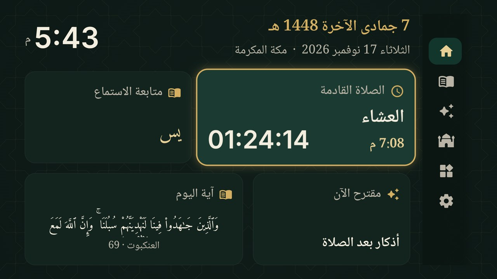

▶️ **[Watch the 1-minute intro video on YouTube](https://www.youtube.com/watch?v=t7oSu_EJR7Y)** ·
**[شاهد فيديو التعريف بالتطبيق (دقيقة واحدة)](https://www.youtube.com/watch?v=t7oSu_EJR7Y)**

**[⬇ Download the APK](https://github.com/MMF/MuslimTV/raw/main/public/MuslimTV.apk)** · Downloader code **2206289** · [Install guide](#install-on-your-tv) ·
[التثبيت بالعربية](#التثبيت-على-التلفاز) · [Wireless debugging](#install-from-a-computer-wireless-debugging)

---

## Features

**Quran**
- Full Uthmani text (Tanzil), browse by surah or juz, bookmarks, search, and "continue where you stopped".
- Listen to 15 well-known reciters; the recited ayah is highlighted as it plays
  (word by word for Mishary Alafasy). Default reciter: Muhammad Siddiq Al-Minshawi.
- Full-screen listening with speed, repeat and sleep timer, and **nature mode**: calm scenery and
  optional ambient sounds behind the recitation.
- Memorization (tahfeez): repeat each ayah or a range, with pauses for you to recite.
- Khatmah planner: finish the Quran in the days you choose, with a daily portion on Home.
- Tafsir, translation, and offline downloads per reciter.

**Azkar**
- Morning, evening, after-prayer, sleep and waking azkar from Hisn al-Muslim, with sources.
- The suggested azkar change with the time of day. Press OK to count each repetition.
- Tasbeeh counter, Asma ul-Husna with meanings, ruqyah.

**Prayer times**
- Accurate offline times for over 34,000 cities, many calculation methods, per-prayer adjustments.
- Full-screen adhan, iqamah countdown, after-prayer azkar, monthly timetable.
- Ramadan mode with suhoor and iftar countdowns; Al-Kahf and Al-Mulk reminders.

**Tools**
- Hijri calendar with occasions and recommended fasting days, qibla direction, hadith of the day,
  Forty Hadith of an-Nawawi, live Makkah and Madinah streams and Quran radio, kids' corner,
  Hajj and Umrah guide.

**For the whole family**
- Profiles: each person keeps their own bookmarks, khatmah and memorization progress.
- Ambient screen after a period of no activity, showing the time, next prayer and an ayah.

## Screenshots

| | |
|---|---|
| 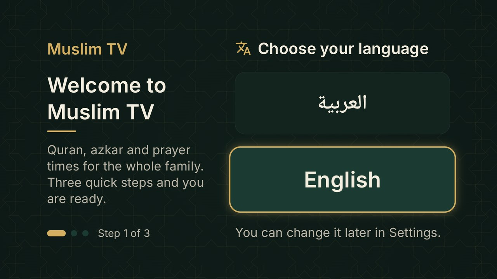 First-launch setup, 3 steps | 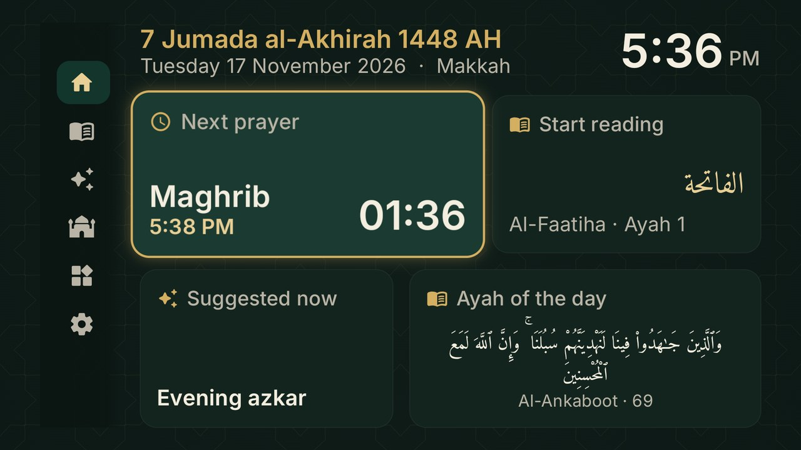 Home in English |
| 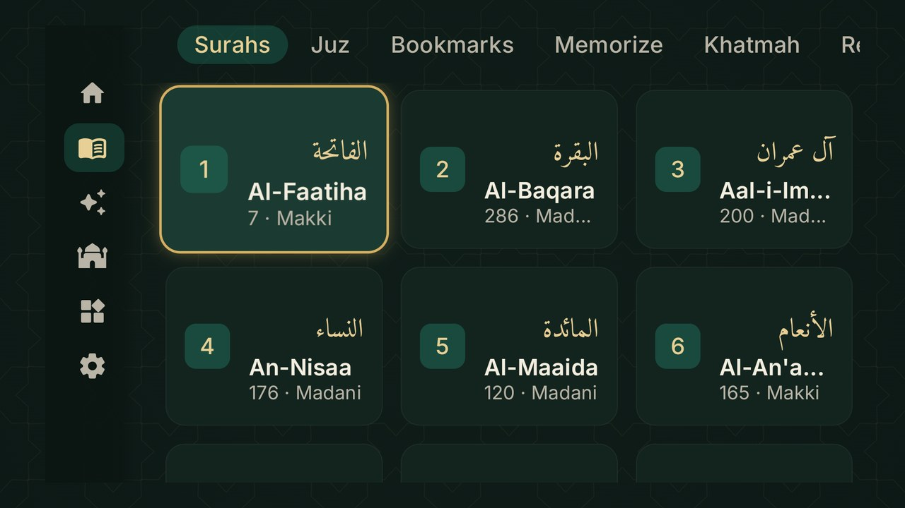 Quran: surahs, juz, bookmarks, memorize, khatmah | 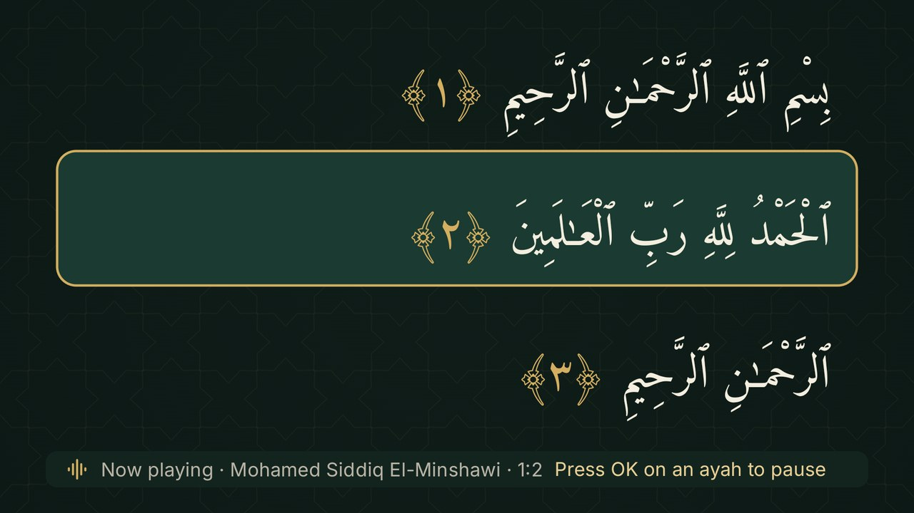 Reader following the recitation |
| 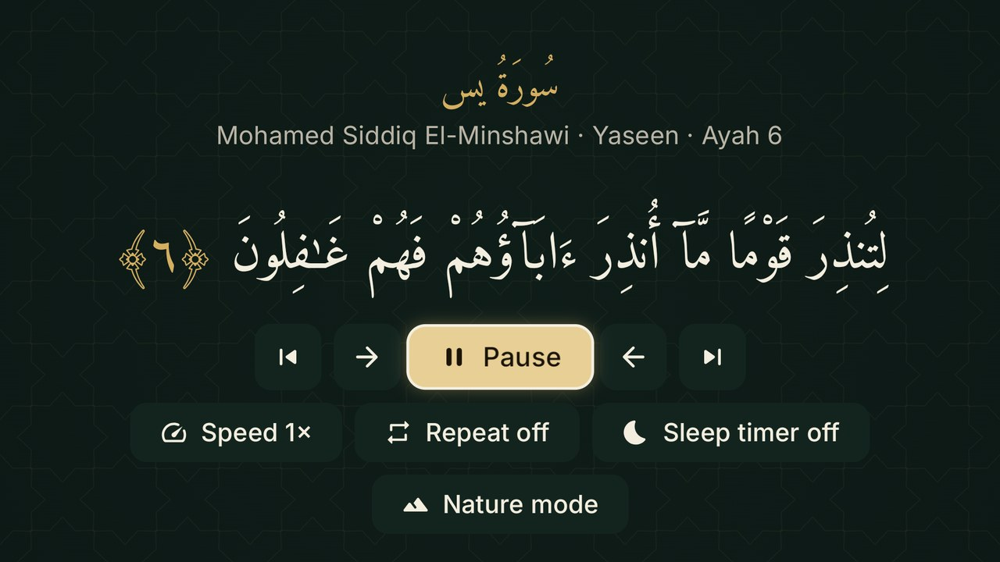 Full-screen listening | 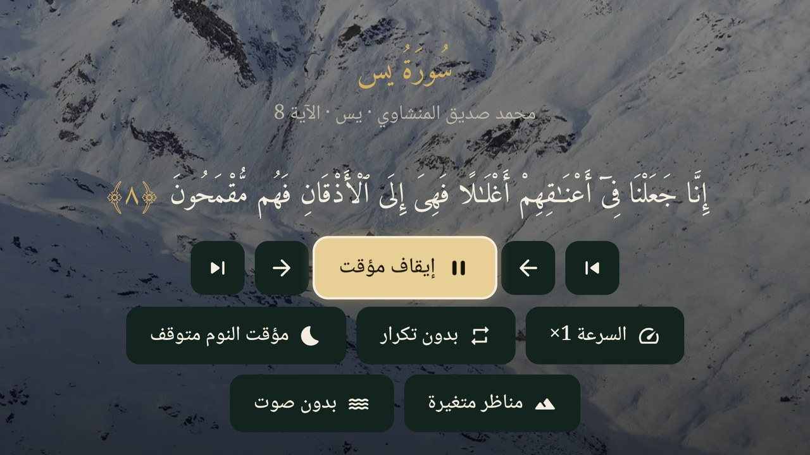 Nature mode |
| 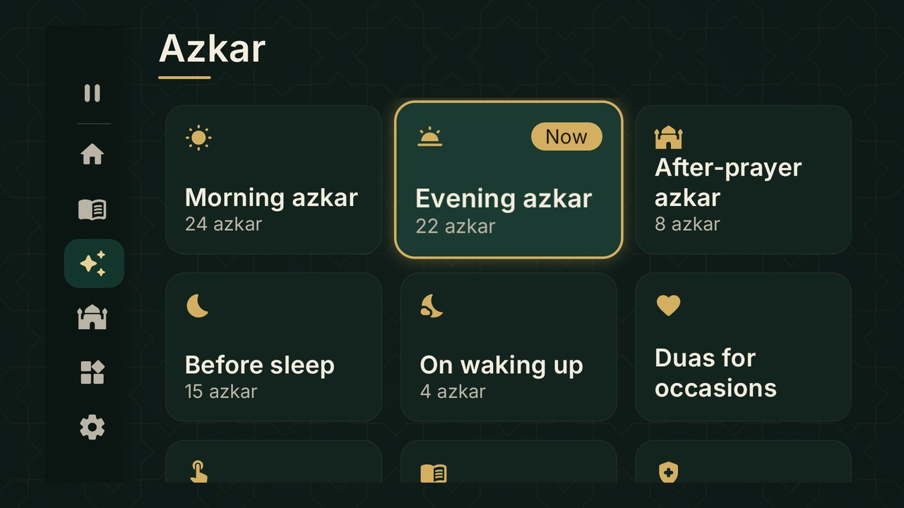 Azkar, with the one for now highlighted | 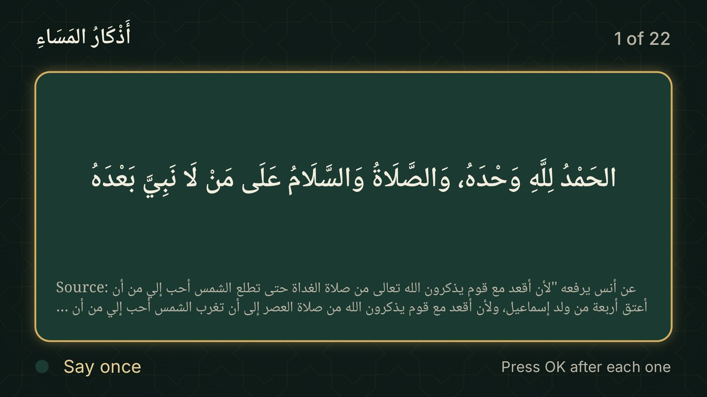 One zikr at a time; OK counts |
| 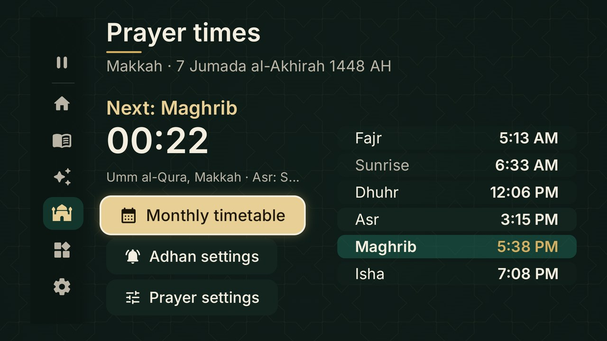 Prayer times | 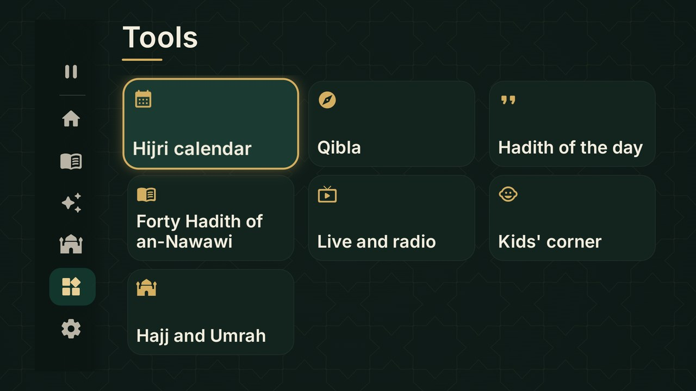 Tools |
| 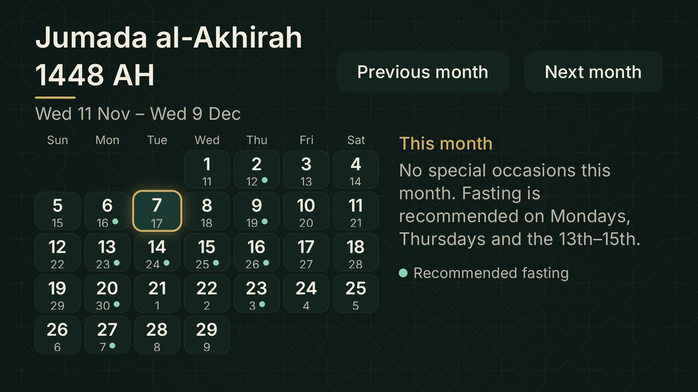 Hijri calendar | |

## Install on your TV

Works on Android TV and Google TV (Android 6.0 or newer), including Chromecast with Google TV,
Sony, TCL, Philips, Xiaomi, and Nvidia Shield.

The app file: [`public/MuslimTV.apk`](public/MuslimTV.apk). Its direct download link is

```
https://github.com/MMF/MuslimTV/raw/main/public/MuslimTV.apk
```

**Downloader code: `2206289`** (AFTVnews short link to the same file, made for typing with a remote).

### Option 1: with the Downloader app (no computer needed)

1. **Install Downloader.** On the TV open the Google Play Store, search for **Downloader**
   (by AFTVnews) and install it.
2. **Allow it to install apps.**
   - **Google TV:** first turn on developer mode: *Settings → System → About →
     Android TV OS build*, press OK on it **7 times** until it says you are a developer.
     Then *Settings → Apps → Security & restrictions → Unknown sources* and turn on **Downloader**.
   - **Android TV:** *Settings → Device Preferences → Security & restrictions → Unknown sources*
     and turn on **Downloader**.
   - If you can't find it, open Downloader and try step 3; the TV will offer a *Settings* button
     that leads straight to the right switch.
3. **Download.** Open Downloader, select the address box, type the code **`2206289`** and press
   **Go**. The code is an AFTVnews short link to the APK above, so there is no long link to type.
   (Typing the full download link also works.)
4. **Install.** When the download finishes, choose **Install**, then **Open**. Afterwards you can
   delete the downloaded file from Downloader to save space.
5. The app appears in the TV's app list as **Muslim TV**. Add it to your favourites to keep it on
   the home screen.

**Updating:** repeat steps 3 and 4 with the same link. Your settings, bookmarks and khatmah are
kept.

### Option 2: from a USB stick

Copy `MuslimTV.apk` to a USB stick, plug it into the TV, and open it with a file manager app such as
**File Commander** or **X-plore**. Allow that app under *Unknown sources* as in step 2 above.

### Option 3: from a computer

See [wireless debugging](#install-from-a-computer-wireless-debugging) below.

### After installing

- Go through the 3-step setup: language, city, calculation method.
- For the **full-screen adhan** to appear over other apps, allow it once in
  *Prayer times → Adhan settings → Show the adhan over other apps*.
  Some TVs also limit apps running in the background; if the adhan doesn't sound, exclude
  Muslim TV from any "power saving" or "app cleaner" setting on the TV.

## Install from a computer (wireless debugging)

Useful for testing, or when the TV has no Play Store.

### 1. Turn on developer options on the TV

- **Google TV:** *Settings → System → About → Android TV OS build*. Press OK **7 times**.
- **Android TV:** *Settings → Device Preferences → About → Build*. Press OK **7 times**.

A message says *"You are now a developer"*. A new **Developer options** menu appears under
*Settings → System* (or *Device Preferences*).

### 2. Turn on debugging

Open **Developer options**. Your TV has one of these:

- **Wireless debugging** (Android 11 and newer, most Google TV devices):
  1. Turn on **Wireless debugging** and open it. Note the **IP address and port** shown on that
     screen, for example `192.168.1.20:37099`.
  2. Choose **Pair device with pairing code**. The TV shows a 6-digit code and *another*
     address with a port, for example `192.168.1.20:41235`.
- **USB debugging / Network debugging / ADB debugging** (older Android TV): turn it on.
  Find the TV's IP address under *Settings → Network & Internet → (your Wi-Fi)*.
  The port is always `5555`.

The computer and the TV must be on the same Wi-Fi network.

### 3. Connect from the computer

Install Google's [Android SDK Platform-Tools](https://developer.android.com/tools/releases/platform-tools)
(it contains `adb`), open a terminal in that folder, then:

```sh
# Wireless debugging (Android 11+): pair once, then connect
adb pair 192.168.1.20:41235        # address from the pairing screen; enter the 6-digit code
adb connect 192.168.1.20:37099     # address from the main Wireless debugging screen

# Older TVs with network / ADB debugging
adb connect 192.168.1.20:5555
```

The first time, the TV asks **"Allow debugging?"**: tick **Always allow from this computer** and
choose **Allow**. Check the connection with `adb devices`; the TV should be listed as `device`.

### 4. Install and open the app

```sh
adb install -r MuslimTV.apk
adb shell am start -n com.mfouad.muslimtv/.MainActivity
```

`-r` updates an existing install and keeps its data. To remove the app:
`adb uninstall com.mfouad.muslimtv`.

When you are done, you can turn wireless debugging off again in Developer options.

---

## التثبيت على التلفاز

**بدون كمبيوتر (تطبيق Downloader):**

1. من متجر Google Play على التلفاز ثبّت تطبيق **Downloader**.
2. اسمح له بتثبيت التطبيقات:
   - **Google TV:** الإعدادات ← النظام ← حول ← Android TV OS build، واضغط OK **سبع مرات**
     لتفعيل وضع المطوّر. ثم الإعدادات ← التطبيقات ← الأمان والقيود ← مصادر غير معروفة،
     وفعّل **Downloader**.
   - **Android TV:** الإعدادات ← تفضيلات الجهاز ← الأمان والقيود ← مصادر غير معروفة،
     وفعّل **Downloader**.
3. افتح Downloader، واكتب في خانة العنوان الرمز **`2206289`** ثم اضغط **Go**.
   الرمز رابط مختصر من AFTVnews يؤدي إلى ملف التطبيق مباشرة (ويمكن أيضًا كتابة رابط التحميل الكامل).
4. بعد انتهاء التحميل اختر **تثبيت** ثم **فتح**. يظهر التطبيق باسم **Muslim TV**.

**للتحديث:** كرّر الخطوتين 3 و4 بالرابط نفسه، وتبقى إعداداتك وعلاماتك وختمتك كما هي.

**ليظهر الأذان بملء الشاشة فوق التطبيقات الأخرى:** مواقيت الصلاة ← إعدادات الأذان ← إظهار الأذان
فوق التطبيقات الأخرى.

**من الكمبيوتر (التصحيح اللاسلكي):** فعّل خيارات المطوّر كما في الخطوة 2، ثم من خيارات المطوّر فعّل
**التصحيح اللاسلكي** (أو **تصحيح USB / الشبكة** في الأجهزة الأقدم)، واتبع أوامر `adb`
في القسم الإنجليزي أعلاه.

---

## Data sources and licences

Quran text from [Tanzil](https://tanzil.net) (verbatim, CC BY 3.0). Recitations are streamed
from [EveryAyah](https://everyayah.com) and word timings come from QUL (Tarteel). Azkar are from
Hisn al-Muslim, cities from GeoNames (CC BY 4.0). Every bundled item, with its author and licence,
is listed in [`CREDITS.md`](CREDITS.md) and on the app's *Settings → Credits* screen.

Guide texts (Hajj and Umrah, kids' corner) are short summaries; for details and special cases,
ask a trusted scholar.

---

## For developers

Kotlin, Jetpack Compose for TV, Media3, Hilt, Room, DataStore, WorkManager. Offline first.

### Build and run

```sh
./gradlew assembleDebug                      # debug APK
./gradlew assembleRelease bundleRelease      # release APK + App Bundle (see Signing)
./gradlew testDebugUnitTest lintDebug        # unit tests + lint
adb install -r app/build/outputs/apk/debug/app-debug.apk
adb shell am start -n com.mfouad.muslimtv/.MainActivity
adb shell pm clear com.mfouad.muslimtv       # reset to first-launch setup
```

Toolchain: AGP 9.2.1 (built-in Kotlin 2.2.10), Gradle 9.4.1, JDK 17 to compile, JDK 21 to run
unit tests (the Adhan library ships Java 21 bytecode). The foojay plugin downloads missing JDKs.

Use the emulator with host GPU (`emulator -avd Television_1080p -gpu host`); with GPU
emulation every frame takes about a second.

### Signing

Release builds are signed with the key described in a `keystore.properties` file at the project
root (never committed):

```properties
storeFile=/path/to/upload.jks
storePassword=...
keyAlias=upload
keyPassword=...
```

Without that file, release builds fall back to the debug key.
`public/MuslimTV.apk` is the signed release build for sideloading.

### Modules

```
app                 single activity, navigation shell (rail + NavHost), Back rules, idle → ambient
core/model          plain Kotlin models + pure logic (alert planner, tahfeez engine, khatmah, tasbeeh)
core/common         dispatchers, time ticker, network monitor
core/designsystem   colors, type, FocusCard, buttons, rows, rail, tabs, dialogs, nature scenes, focus restore
core/ui             shared strings, labels, time/date formatting, language switch, city picker
core/datastore      settings (Preferences DataStore)
core/database       Room: Quran text, notes, bookmarks, positions, downloads, tahfeez, profiles, khatmah
core/data           repositories: settings, cities, Quran, audio sources, timings, azkar, hadith, tools
core/media          playback service (Media3 session), Quran player, play cache, ambient sounds
core/downloads      download queue (WorkManager), size estimate, storage guard
feature/onboarding  first-launch setup
feature/home        dashboard, ambient screen
feature/quran       browse, reader, listening, nature mode, tahfeez, khatmah
feature/azkar       categories, zikr pager, tasbeeh, Asma ul-Husna, ruqyah
feature/prayer      today, month, adhan alarms/screen/service, reminders
feature/downloads   download manager and storage
feature/tools       Hijri calendar, qibla, hadith, live and radio, kids, Hajj and Umrah
feature/settings    settings, profiles, credits
```
